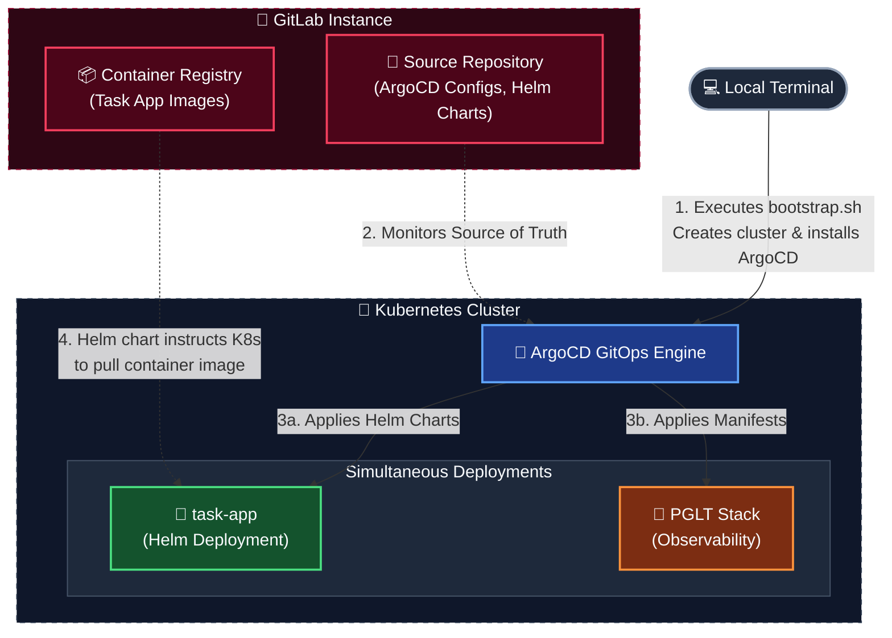
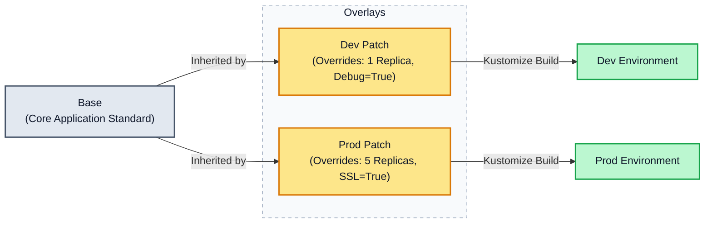
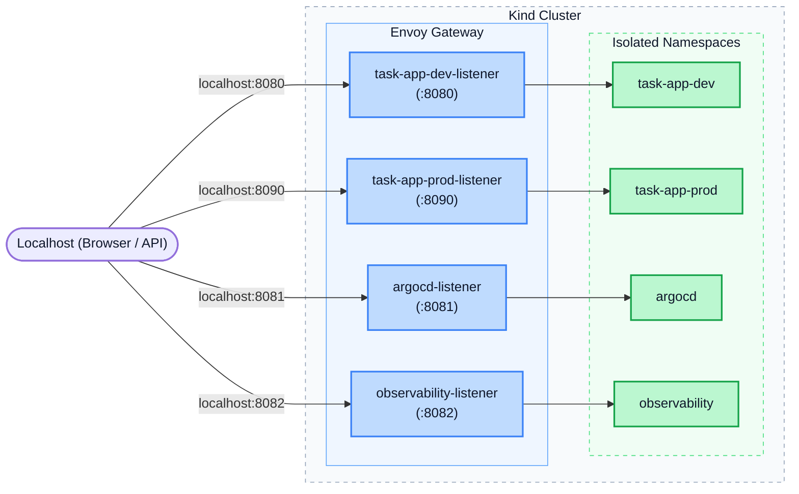
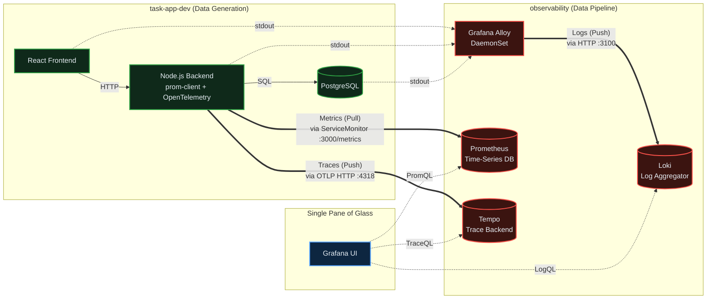

# DevOps Capstone Project: 3-Tier Task Management Application

This repository contains a task management application and its complete DevOps implementation. The project demonstrates modern DevOps practices including containerization, Kubernetes orchestration, CI/CD pipelines, and GitOps workflows.

## Why use Kubernetes
- Traditional deployments 
    - Rely on manual container composition to scale, update, or recover from crashes. 
    - Difficult to synchronize with multiple developers.
- Container orchestration 
    - Automates operational burdens, shifting the focus from managing servers to managing applications.
    - Scalable to a shared CI repository as a single source of truth.

## Implementation Requirements

1. **Local Kubernetes Environment (20%)**
2. **Helm Chart Development (20%)**
3. **GitLab CI Pipeline (20%)**
4. **ArgoCD Implementation (20%)**
5. **Observability Stack Implementation (20%)**

## Infrastructure Flowchart

### From local terminal:
1. Push application code to Gitlab Repository.
2. Gitlab Project Runner builds and push container Images to Gitlab Container Registry.
3. Execute bootstrap bash script to install manifests and initialize ArgoCD.
4. ArgoCD reads Gitlab Repository.
5. ArgoCD deploys helm task-app application and observability applicationset.
6. Helm chart pulls images from container registry.
7. Manage application with ArgoCD.



## Kustomize Design Philosophy


> **"The Base is the Standard; Overlays are the Exceptions."**

### Base (The Standard)
**Base** represents the default state of your application. It contains the core Kubernetes manifests and standard configurations that remain true regardless of where the application is deployed.

### Overlays (The Exceptions)
**Overlays** apply environment specific modifications on top of the base configuration with specific values for environments like **Dev**, **Staging**, or **Prod**.



### Why This Architecture Is Best Practice
Keeps the core application architecture clean and strictly isolates the foundational setup from environment-specific adjustments. This yields three major benefits:
* **Eliminates Duplication:** maintain only one copy of core infrastructure.
* **Safer Global Updates:** Base changes automatically cascades to all environments.
* **Clear Auditability:** Easily trace the difference between Prod and Dev configurations.

## Directory Structure

This repository is structured as a complete GitOps deployment environment. It strictly separates application source code from infrastructure state, establishing Git as the single source of truth for the Kubernetes cluster.

* **app/:** The raw application source code (frontend, backend, database).
* **argocd/:** The definitions that instruct ArgoCD to monitor the **kubernetes/** manifests and automatically deploy them to the cluster.
* **bootstrap/:** Scripts and manifests for initial spin up the cluster and seed core encryption keys.
* **kubernetes/:** The deployment blueprints using Helm, defining how the app is deployed with base and overlay.
* **observability/:** The monitoring stack that scrape and log the application metrics.

```
.
├── .gitlab-ci.yml
├── Dashboard.json
├── app/
│   ├── backend/
│   ├── database/
│   └── frontend/
├── argocd/
│   ├── infrastructure/
│   │   ├── argocd-httproute.yaml
│   │   └── read-repo-sealed-secrets.yaml
│   ├── observability/
│   │   └── pglt-stack.yaml
│   └── task-app/
│       ├── task-app-dev.yaml
│       └── task-app-prod.yaml
├── bootstrap/
│   ├── manifests/
│   │   ├── argo-params.yaml
│   │   ├── envoy-gateway.yaml
│   │   ├── kind-config.yaml
│   │   └── .master-sealed-secret-key.yaml
│   └── scripts/
│       ├── bootstrap.sh
│       └── teardown.sh
└── kubernetes/
    ├── base/
    │   ├── observability/
    │   │   ├── alloy-base.yaml
    │   │   ├── loki-base.yaml
    │   │   ├── prometheus-base.yaml
    │   │   └── tempo-base.yaml
    │   └── task-app/
    │       └── task-app-values-base.yaml
    ├── overlays/
    │   ├── dev/
    │   │   ├── observability/
    │   |   └── task-app/
    │   |       ├── sealed-secrets/
    │   |       └── task-app-values-patch.yaml
    │   └── prod/
    │       ├── observability/
    │       └── task-app/
    │           ├── sealed-secrets/
    │           └── task-app-values-patch.yaml
    └── helm/
        └── task-app/
            ├── Chart.yaml
            └── templates/
                ├── backend/
                ├── database/
                ├── frontend/
                └── routes/
```

## 1. Local Kubernetes Environment

- [✅] Local cluster setup (kind) 
- [✅] Namespace configuration
- [✅] Ingress setup

### 1.1. One-Click Orchestration
All manifest installations are compiled in the **bootstrap/** directory for a centralized one-click environment provisioning and teardown.

```
.
└── bootstrap/
    ├── manifests/
    │   ├── argo-params.yaml
    │   ├── envoy-gateway.yaml
    │   ├── kind-config.yaml
    │   └── .master-sealed-secret-key.yaml
    ├── bootstrap.sh
    └── teardown.sh
```

### 1.2. Cluster Initialization (kind)

 The bootstrap.sh script handles cluster lifecycle management.
- Checks for existing kind cluster,
- If none is found, automatically create new local cluster.

```
if kind get clusters | grep -qx "${CLUSTER_NAME}"; then
    echo "[+] Cluster $CLUSTER_NAME already exists."
    NEW_CLUSTER=false
else
    echo "[~] Creating Kind cluster..."
    kind create cluster --name "$CLUSTER_NAME" --config "$KIND_CONFIG"
    NEW_CLUSTER=true
fi
```

### 1.3. Namespace configuration

During initialization, **bootstrap.sh** automatically provisions the necessary namespaces to enforce logical isolation across the stack:
 - **[argocd]**               - argocd
 - **[envoy-gateway-system]** - ingress 
 - **[kube-system]**          - sealed-secrets
 - **[observability]**        - observability stack
 - **[task-app-dev]**         - helm chart app

### 1.4. Ingress setup

**Cluster Port Mapping (kind-config.yaml):** 
- Binds local machine ports to the kind container nodes, allowing traffic to enter the local Kubernetes network.

**Gateway Listeners (envoy-gateway.yaml):**
- Bind the exposed ports and explicitly route incoming traffic to designated environment listeners.

**Routing Configuration:**
  - Port **8080** - task-app-dev-listener
  - Port **8090** - task-app-prod-listener
  - Port **8081** - argocd-listener
  - Port **8082** - observability-listener



## 2. Helm Chart Development

- [✅] Configuration management
- [✅] Application Helm charts
- [✅] Secret handling

### 2.1. Helm templates with configmap, deployment, services. For consistent parameters and deterministic values across multiple clusters. 

```
.
└── kubernetes/
    └── helm/
        └── task-app/
            ├── Chart.yaml
            └── templates/
                ├── backend/
                ├── database/
                ├── frontend/
                └── routes/
```

### 2.2. Configuration management

```
backend/
├── backend-configmap.yaml
├── backend-deployment.yaml
├── backend-service.yaml
└── backend-servicemonitor.yaml

database/
├── postgres-configmap.yaml
├── postgres-service.yaml
└── postgres-statefulset.yaml
 
frontend/
├── frontend-configmap.yaml
├── frontend-deployment.yaml
└── frontend-service.yaml

routes/
└── task-app-httproute.yaml
```

### 2.3. Application Helm charts

**[1]** Primary Helm Chart source is the gitlab repository. Repository is the Source of truth.

#### argocd/task-app/task-app-dev.yaml
- repoURL: *https://gitlab.stratpoint.cloud/devops-bootcamp/interns-batch2026-2/devops-magdamo-bien/piping-devops-pipelines.git*

**[2]** Values are applied sequentially with base and overlay values. Base-values are constant, overlay patch-values are for changes.

```
.
└── kubernetes/
    ├── base/
    │   └── task-app/
    │       └── task-app-values-base.yaml.
    └── overlays/
        ├── dev/
        │   └── task-app/
        │       └── task-app-values-patch.yaml 
        └── prod/
            └── task-app/
                └── task-app-values-patch.yaml
```

- **First Base:** Apply base values to task-app helm chart
    - *kubernetes/base/task-app/task-app-values-base.yaml*

- **Second Overlay:** inject environment specific adjustments to base-values.yaml
    - *kubernetes/overlays/dev/task-app/task-app-values-patch.yaml*

### 2.4. Secret handling

#### [Sealed-Secrets]
- Sealed-secrets are used to asymmetrically encrypt secrets. 
    - Secrets are only stored to overlays, never to base. 
    - Each env overlay has different encrypted secrets. Can be pushed to repo.
    - Each cluster instance has a master-key againsts all secrets. Should be in gitignore.

```
.
└── kubernetes/
    └──  overlays/
        ├── dev/
        |   └── task-app/
        |       └── sealed-secrets/
        └── prod/
            └── task-app/
                └── sealed-secrets/
```

#### [Backend-Secrets]
```
kubectl create secret generic backend-secrets \
  --namespace task-app-dev \
  --from-literal=DB_USER=postgres \
  --from-literal=DB_PASSWORD=postgres \
  --dry-run=client -o yaml | \ 
kubeseal --format=yaml \
  --controller-name=sealed-secrets \
  --controller-namespace=kube-system \
  > kubernetes/overlays/dev/task-app/sealed-secrets/dev-backend-sealed-secrets.yaml
```

#### [Database-Secrets]
```
kubectl create secret generic postgres-secrets \
  --namespace task-app-dev \
  --from-literal=POSTGRES_USER=postgres \
  --from-literal=POSTGRES_PASSWORD=postgres \
  --dry-run=client -o yaml | \
kubeseal --format=yaml \
  --controller-name=sealed-secrets \
  --controller-namespace=kube-system \
  > kubernetes/overlays/dev/task-app/sealed-secrets/dev-postgres-sealed-secrets.yaml
```

### [IMPORTANT] 
- Make sure to export master-key before deleting cluster, and import when creating new cluster. 
- Store the master key in a secure shared location for DevOps.

```
_MASTER_KEY="./path/to/.master-sealed-secret-key.yaml"

kubectl get secret -n kube-system \
   -l sealedsecrets.bitnami.com/sealed-secrets-key \
   -o yaml | sed '/resourceVersion:/d; /uid:/d; /creationTimestamp:/d; /managedFields:/d' > "$_MASTER_KEY"
```

## 3. GitLab CI Pipeline

- [✅] Automated build pipeline
- [✅] Container image management
- [✅] Deployment automation

### 3.1 Automated build pipeline

#### [Runners]
- Created Project runners for specific repository
    - Go to Gitlab > Repository > Settings > CI/CD > Runners > Project Runner
    - Create 'New project runner'
        - Specificy tags or run untagged jobs
        - Optional Configurations (Paused, Protected, Lock to current project)
    - After creation, copy token.

- Configure gitlab-runner in WSL
    - Install gitlab-runner: *"https://docs.gitlab.com/runner/install/linux-repository/"*

- Register token to gitlab-runner.

```
sudo gitlab-runner register \
--non-interactive \
--url "https://gitlab.stratpoint.cloud/" \
--token "YOUR_RUNNER_AUTHENTICATION_TOKEN" \
--executor "docker" \
--docker-image "alpine:latest" \
--description "automated-docker-runner" \
--tag-list "docker,linux" \
--run-untagged="true"
```

### 3.2. Container image management

The ***.gitlab-ci.yml*** pipeline automates the containerization process. When code is pushed, the locally installed **GitLab Runner** triggers a Docker-in-Docker (DinD) build, creates the updated images, and pushes them to the GitLab Container Registry.

#### Stages & Variables
- Defines the core build stage and configures the Docker daemon for DinD execution without TLS overhead.
```
stages:
  - build

variables:
  DOCKER_TLS_CERTDIR: ""
  DOCKER_HOST: tcp://docker:2375
  FF_NETWORK_PER_BUILD: "true"
```

#### Registry Authentication (Base Template)
- Uses a hidden base template (.build_images_base) to keep the pipeline **DRY**. It configures the Docker service, sets retry limits for transient runner failures, and authenticates with the GitLab Container Registry before executing scripts.
```
.build_images_base:
  image: docker:24.0.5
  services:
    - docker:24.0.5-dind
  retry:
    max: 2
    when: 
      - runner_system_failure
      - stuck_or_timeout_failure
  before_script:
    - docker login -u $CI_REGISTRY_USER -p $CI_REGISTRY_PASSWORD $CI_REGISTRY
```
#### Build & Push Execution
- Targeted jobs extend the base configuration to build the frontend and backend. Using ***rules: changes***, these jobs only trigger when there are changes within their respective application directories. Images are tagged with both the specific commit SHA and latest tags.
```
build_frontend:
  extends: .build_images_base
  stage: build
  script:
    # Build and push frontend
    - docker build 
        -t $CI_REGISTRY_IMAGE/frontend:$CI_COMMIT_SHORT_SHA 
        -t $CI_REGISTRY_IMAGE/frontend:latest 
        ./app/frontend
    - docker push $CI_REGISTRY_IMAGE/frontend:$CI_COMMIT_SHORT_SHA
    - docker push $CI_REGISTRY_IMAGE/frontend:latest
  rules:
    # Execute if there are changes to frontend
    - changes:
        - app/frontend/**/*

build_backend:
  extends: .build_images_base
  stage: build
  script:
    # Build and push backend
    - docker build 
        -t $CI_REGISTRY_IMAGE/backend:$CI_COMMIT_SHORT_SHA
        -t $CI_REGISTRY_IMAGE/backend:latest 
        ./app/backend
    - docker push $CI_REGISTRY_IMAGE/backend:$CI_COMMIT_SHORT_SHA
    - docker push $CI_REGISTRY_IMAGE/backend:latest
  rules:
    # Execute if there are changes to backend
    - changes:
        - app/backend/**/*
```

### 3.3 Deployment automation

#### Decoupled Dual-Pipeline Architecture
- **Container Pipeline (CI):** When pushed to Gitlab, ***gitlab-ci.yml*** automatically builds the application code and pushes the compiled Docker images directly to the Container Registry.

- **Infrastructure Pipeline (CD):** Kubernetes (via ArgoCD) monitors the registry and manifests, automatically pulling the updated container images and orchestrating the rollout to the cluster.
#### Local Execution
- To run locally, run **bootstrap.sh** script to spin up the kind cluster, apply the Gateway, and seed the local secrets.
```
.
└── bootstrap/
    ├── manifests/
    │   ├── argo-params.yaml
    │   ├── envoy-gateway.yaml
    │   ├── kind-config.yaml
    │   └── .master-sealed-secret-key.yaml
    ├── bootstrap.sh
    └── teardown.sh
```

## 4. ArgoCD Implementation

- [✅] GitOps workflow
- [✅] Application synchronization
- [✅] Deployment management

### 4.1 ArgoCD directory
Contains ArgoCD Application custom resources. These config files act as source and destination pointers, telling ArgoCD exactly which Git repository to monitor and which path to deploy into the cluster.
```
.
└── argocd/
    ├── infrastructure/
    │   ├── argocd-httproute.yaml           # Ingress rules for Argo UI
    │   └── read-repo-sealed-secrets.yaml   # Credentials for Argo to read the private repo
    ├── observability/
    │   └── pglt-stack.yaml                 # Points to the observability stack
    └── task-app/                           
        ├── task-app-dev.yaml               # Points to base code + dev overlays
        └── task-app-prod.yaml              # Points to base code + prod overlays
```
### 4.2. GitOps workflow
During the initial setup, **bootstrap.sh** installs the required helm chart dependencies: **Envoy Gateway, ArgoCD, Sealed-Secrets.**

```
helm upgrade --install eg oci://docker.io/envoyproxy/gateway-helm \
    --version v1.9.0 \
    -n envoy-gateway-system \
    --create-namespace \
    --wait

helm upgrade --install argocd argo/argo-cd \
    --namespace argocd \
    --create-namespace \
    --timeout 15m \
    -f "$ARGO_CONFIG" \
    --wait

helm upgrade --install sealed-secrets bitnami/sealed-secrets \
    --namespace kube-system \
    --create-namespace \
    --wait
```
After installing the necessary dependencies, **bootstrap.sh** then applies the ArgoCD configurations directly to the cluster. Once these manifests are applied, ArgoCD takes over the deployment lifecycle entirely.
```
TASK_APP_PATH="${BASH_DIR}/../argocd/task-app/${APP_NAME}.yaml"

echo "[~] Applying Argocd manifests..."
kubectl apply -f $BASH_DIR/../argocd/infrastructure

echo "[~] Applying Observability manifests (Grafana, Prometheus, Alloy, Loki, Tempo)..."
kubectl apply -f $BASH_DIR/../argocd/observability

echo "[~] Applying $ENV ArgoCD Application..."
if [ -f "$TASK_APP_PATH" ]; then
  kubectl apply -f "$TASK_APP_PATH"
else
  echo "[!] Error: Environment file '$TASK_APP_PATH' not found!"
  exit 1
fi
```

### 4.3. Application synchronization
- Each ArgoCD application is configured with a strict, automated syncPolicy to automatically synchronize the cluster state to match the GitLab repository,when it detects changes in the remote repository. 
- If a pod or a service is manually changed against the repository cluster state, ArgoCD's selfHeal will instantly overwrite the changes to match Git.
```
syncPolicy:
    automated:
      prune: true      # Automatically delete resources that are removed from Git
      selfHeal: true   # Revert manual changes made via kubectl
    syncOptions:
      - CreateNamespace=true
```

#### The Bootstrap Override: 
- The **bootstrap.sh** script can also force a hard refresh and synchronization. Forcing Kubernetes to perform a rolling restart of ALL deployments in the namespace to immediately apply the fresh state

```
echo "[~] Refreshing ArgoCD application $APP_NAME."
kubectl annotate application ${APP_NAME} -n argocd argocd.argoproj.io/refresh=normal --overwrite || true

sleep 10

echo "[~] Triggering rolling restart for all deployments in namespace ${APP_NAME}..."
kubectl rollout restart deployment -n ${APP_NAME}

for deployment in $(kubectl get deployments -n ${APP_NAME} -o name); do
  echo "[~] Waiting for $deployment to complete..."
  kubectl rollout status $deployment -n ${APP_NAME}
done
```

### 4.3. Deployment management

#### Once the cluster is bootstrapped, all deployment management happens through Git commits.
- **Promoting to Production:** To deploy a new version, update the image tag in kubernetes/overlays/prod/task-app/task-app-values-patch.yaml and commit the change. ArgoCD automatically detects this commit and rolls out the new pods.

- **Zero-Downtime Rollouts:** Kubernetes natively handles rolling updates, ensuring new pods are fully healthy before terminating the old ones, keeping the application online during updates.

- **Instant Rollbacks:** If a bad deployment goes out and crashes the site, resolving it doesn't require complex scripts. You simply run git **"revert <(commit-hash)>"** in the repository. ArgoCD sees the reverted code and instantly rolls the cluster back to the previous stable state.


## 5. Observability Stack
- [✅] Prometheus metrics collection
- [✅] Grafana dashboards and visualization
- [✅] Loki log aggregation
- [✅] Tempo distributed tracing
- [✅] Application instrumentation

### 5.1. Stack Overview

The observability architecture utilizes a centralized "Single Pane of Glass" model deployed via ArgoCD in the observability namespace. It collects telemetry from across the Kubernetes cluster and exposes a unified Grafana interface routed through Envoy Gateway.



- **Prometheus (Metrics):** Collects time-series data. It uses a dynamic ServiceMonitor to actively pull infrastructure usage, HTTP request rates, and custom business metrics directly from the application's /metrics endpoint.

- **Loki & Alloy (Logs):** Grafana Alloy runs as a DaemonSet, automatically intercepting standard output (stdout/stderr) from all cluster pods. It enriches these logs with Kubernetes metadata and pushes them to Loki for persistent, queryable storage without requiring application-level log shipping logic.

- **Tempo (Traces):** Receives distributed tracing data directly from the application. It maps the complete lifecycle of a request, from the initial HTTP entry point down to the specific database SQL queries.

- **Grafana (Visualization):** The central UI configured via GitOps. Data sources (Prometheus, Loki, Tempo) are auto-provisioned at startup.

### 5.2. Application Instrumentation

The Node.js backend is fully instrumented to expose telemetry to the observability stack:

- **OpenTelemetry (OTel):** The backend utilizes **@opentelemetry/sdk-node** and **auto-instrumentation** libraries, injected at startup via ***instrumentation.js.*** It automatically wraps Express routes and PostgreSQL (pg) drivers to generate Trace IDs and span durations, pushing them to Tempo over HTTP via OTLP.

- **Prom-Client (Metrics):** The backend utilizes the **prom-client** library to expose a **/metrics** route. A custom middleware tracks ***http_request_duration_seconds*** (categorized by **method**, **route**, and **status**), while custom counters track business logic like ***tasks_created_total***.

```
./app/backend/src/server.js

// HTTP Requests Rate
const httpRequestDuration = new client.Histogram({
  name: 'http_request_duration_seconds',
  help: 'Duration of HTTP requests in seconds',
  labelNames: ['method', 'route', 'status'],
  buckets: [0.1, 0.3, 0.5, 1, 1.5, 2, 5] // Time buckets in seconds
});

// Tasks Created
const tasksCreatedCounter = new client.Counter({
  name: 'tasks_created_total',
  help: 'Total number of tasks created',
  labelNames: ['status']
});

tasksCreatedCounter.inc({ status: 'TODO' }, 0);
tasksCreatedCounter.inc({ status: 'IN_PROGRESS' }, 0);
tasksCreatedCounter.inc({ status: 'DONE' }, 0);

// Tasks Completed
const tasksCompletedCounter = new client.Counter({
  name: 'tasks_completed_total',
  help: 'Total number of tasks completed',
  labelNames: ['status']
});

tasksCompletedCounter.inc({ status: 'DONE' }, 0);

// User Activity
const userActivityCounter = new client.Counter({
  name: 'user_activity_total',
  help: 'Total user interactions by action type',
  labelNames: ['action']
});

userActivityCounter.inc({ action: 'list_tasks' }, 0);
userActivityCounter.inc({ action: 'create_task' }, 0);
userActivityCounter.inc({ action: 'update_task' }, 0);
userActivityCounter.inc({ action: 'delete_task' }, 0);
```

### 5.3. Dashboard Management

**Application Metrics:**
- HTTP request rate
- Response times
- Error rates
- Active users

**Infrastructure Metrics:**
- CPU usage
- Memory usage
- Pod restarts
- Network traffic

**Business Metrics:**
- Tasks created
- Tasks completed   
- User activity

